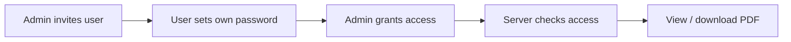

# 📁 Document Access Portal – Overview

> ⚠️ **Overview only.** The real project is private because it contains confidential information. This repository contains no source code or real data.

## Why
Share confirmation PDFs securely, so each person only sees the documents they are allowed to see.

## Workflow

## Tech
Node.js · Server-side sessions

---

### 🤖 How it was built

Built by integrating **AI and AI agents** into the development process. I designed the solution, defined the requirements and parameters, and tested the project until it worked correctly.
